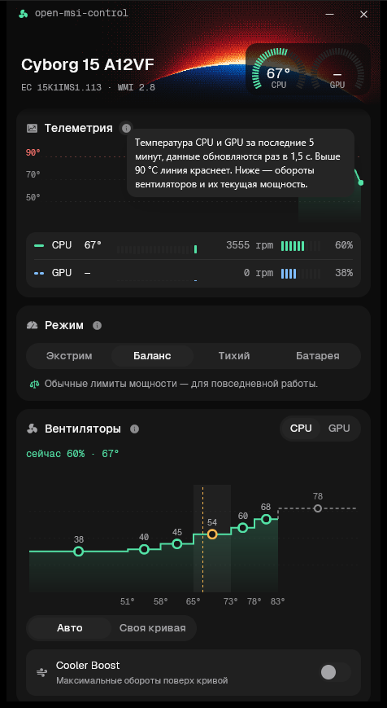

# open-msi-control

A small, fast replacement for the cooling, performance and battery parts of **MSI Center** on
MSI laptops. Native Rust, GPU-rendered UI ([gpui](https://gpui.rs)), no background services.

<p align="center"></p>

## Features

- **Live telemetry** — CPU/GPU temperature gauges, temperature timeline over 5 min, 1 h or 24 h
  (red above 90 °C) with hover readout, fan RPM and EC target duty; CSV export of the history.
- **Scenarios** — Extreme Performance, Balanced, Silent, Super Battery (the same registers MSI
  Center writes).
- **Fan curves** — drag the six editable points per fan (CPU and GPU), apply or revert; curves
  stay monotonic and never exceed the firmware's top point. Auto mode and Cooler Boost.
- **Battery charge limit** — slider (40–100 %) and the Battery Master presets (100/80/60 %).
- **Profiles** — the app re-applies your scenario, fan curves, Cooler Boost and charge limit after
  boot, wake and power changes (MSI Center Service overwrites them); optionally a separate profile
  on battery and on AC.
- **System** — keyboard backlight, touchpad, webcam kill switch, Win/Fn swap, USB power share,
  Fn Lock state.
- **Tray** — close to tray; left click opens a flyout with temperatures, scenarios, fan mode,
  Cooler Boost and charge presets; right click opens quick actions; the icon tooltip shows CPU/GPU
  temperatures. One instance only.
- **Start with Windows** — a Task Scheduler logon task starts the app elevated in the tray without
  a UAC prompt (it runs on battery too).
- Russian and English UI (follows the Windows display language, switchable in the App card), (i)
  hints explaining every setting.
- Daily update check against GitHub Releases (can be turned off). Settings live in
  `%APPDATA%\open-msi-control\settings.json`.
- Keyboard navigation (Tab, arrows, Enter/Space) with focus rings, WCAG AA contrast, honours the
  Windows "Animation effects" setting.

## Supported hardware

Developed and verified on **MSI Cyborg 15 A12VF** (board MS-15K1, EC `15K1IMS1.113`). Other MSI
laptops whose firmware reports MSI WMI interface **2.x** are supported through the model table of
the Linux [msi-ec](https://github.com/BeardOverflow/msi-ec) driver: the EC firmware version picks
one of its 21 register layouts (373 firmware versions), and controls the model lacks are hidden.
Those layouts are msi-ec's and not verified on hardware by this project. Firmware msi-ec does not
list gets the Cyborg 15 layout and the header shows *Model not recognised*. The app refuses to
start on other interface versions.

Got another model? Run `msi-probe.exe` (read-only; it prints the layout the app would use) and
open a *Support a new laptop model* issue.

## Install / run

Requires Windows 10/11 x64 and Administrator rights (the firmware interface is restricted to
Administrators; the executable requests elevation).

Download the latest build from [Releases](https://github.com/riclenatin/open-msi-control/releases):

- `open-msi-control-<version>-setup.exe` — installer with a Start menu shortcut (desktop shortcut
  optional) and an uninstaller. Uninstalling also removes the *Start with Windows* task; your
  settings are kept.
- `open-msi-control-<version>-portable.zip` — unzip anywhere and run `open-msi-control.exe`.

Both include `msi-probe.exe`.

To build and run from source:

```sh
cargo run --release
```

Building needs Rust stable, Visual Studio Build Tools (C++ workload) and the Windows SDK
(`fxc.exe`, used by gpui to compile shaders).

> MSI Center can stay installed. Its service re-applies its own scenario at boot and after sleep;
> with *Restore settings* on (the default) the app puts yours back within seconds.

## How it works

The firmware exposes an ACPI-WMI bridge, `root\WMI:MSI_ACPI`. The app reads sensors and writes a
handful of embedded-controller bytes through it, exactly like MSI Center does, always as
read-modify-write of single bytes. See [`docs/PROTOCOL.md`](docs/PROTOCOL.md) for the register
map and how it was derived.

| Crate | Purpose |
|---|---|
| `crates/msi-acpi` | Library: WMI transport, EC feature layer, hardware thread |
| `crates/app` | The `open-msi-control` desktop app |
| `crates/probe` | `msi-probe` diagnostic dump |

## Disclaimer

Not affiliated with MSI. Writing to the embedded controller is at your own risk; the app only
touches registers verified on real hardware or listed by msi-ec for your EC firmware, and keeps
all other bits intact.

## License

[GPL-2.0-or-later](LICENSE). Model register tables are derived from the Linux
[msi-ec](https://github.com/BeardOverflow/msi-ec) driver (GPL-2.0).
Bundled fonts: Geist (SIL OFL 1.1). Icons: Phosphor (MIT).
